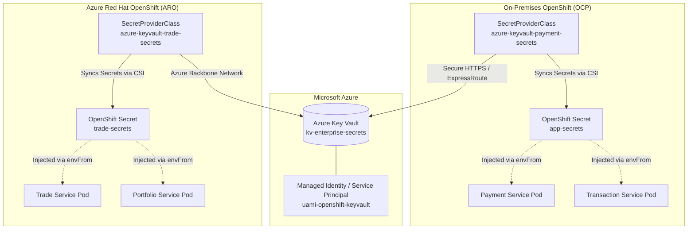

# Azure Key Vault Unified Secrets Management Guide

This guide details how **Azure Key Vault** serves as the single, unified enterprise secrets engine for **both On-Premises OpenShift Container Platform (OCP)** and **Azure Red Hat OpenShift (ARO)**.

---

## 1. Unified Hybrid Cloud Security Architecture



---

## 2. Automated Provisioning

Run the included automated setup script to provision the Azure Key Vault, create all secrets, and configure RBAC roles:

```bash
# Authenticate to Azure CLI
az login

# Set your target Azure subscription (if multiple exist)
az account set --subscription "<YOUR_SUBSCRIPTION_ID>"

# Execute provisioning script
./azure-keyvault/setup-azure-keyvault.sh
```

---

## 3. How Clusters Connect to Azure Key Vault

Both On-Premises and ARO clusters utilize the **Secrets Store CSI Driver** with the **Azure Provider** (`csi-secrets-store-provider-azure`).

### 3.1 ARO Cluster Connection (Managed Identity)
- **Authentication**: ARO nodes leverage Azure User-Assigned Managed Identity (`useVMManagedIdentity: "true"`).
- **Manifest**: [`ARO-Microservice-1/deployment/02-secret-provider-class.yaml`](../ARO-Microservice-1/deployment/02-secret-provider-class.yaml)
- **OpenShift Secret**: Automatically synchronizes secrets into `trade-secrets` in namespace `trade-app`.

### 3.2 On-Premises OpenShift Connection (Service Principal or Workload Identity)
- **Authentication**: On-prem nodes authenticate to Azure Key Vault via outbound HTTPS (port 443) using an Azure Entra ID Service Principal or Workload Identity federation.
- **Manifest**: [`On-Prem-Microservice-1/deployment/02-secret-provider-class.yaml`](../On-Prem-Microservice-1/deployment/02-secret-provider-class.yaml)
- **OpenShift Secret**: Automatically synchronizes secrets into `app-secrets` in namespace `payment-app`.

---

## 4. Local Development without Local Vault

Because credentials are stored in Azure Key Vault, developers do not need to run a local HashiCorp Vault server or store passwords in files.

You can populate your local shell environment directly from Azure Key Vault using the Azure CLI:

```bash
# Set vault name
export KEYVAULT_NAME="kv-enterprise-secrets"

# Fetch credentials directly into environment variables
export APP_SECURITY_USER=$(az keyvault secret show --vault-name $KEYVAULT_NAME --name "payment-api-user" --query value -o tsv)
export APP_SECURITY_PASSWORD=$(az keyvault secret show --vault-name $KEYVAULT_NAME --name "payment-api-password" --query value -o tsv)

# Run the microservice locally
cd payment-service
./mvnw spring-boot:run
```

---

## 5. Secret Rotation Workflow

When rotating passwords or API keys:
1. Update the secret version in Azure Key Vault:
   ```bash
   az keyvault secret set --vault-name kv-enterprise-secrets --name "payment-api-password" --value "<NEW_PASSWORD>"
   ```
2. The Secrets Store CSI Driver periodically polls Azure Key Vault (default: every 2 minutes), updates the mounted files in `/mnt/secrets-store`, and refreshes the native Kubernetes Secret.
3. Trigger a rolling restart of the pods to pick up refreshed environment variables:
   ```bash
   # On-Prem
   oc rollout restart deployment/payment-service -n payment-app
   
   # ARO
   oc rollout restart deployment/trade-service -n trade-app
   ```
