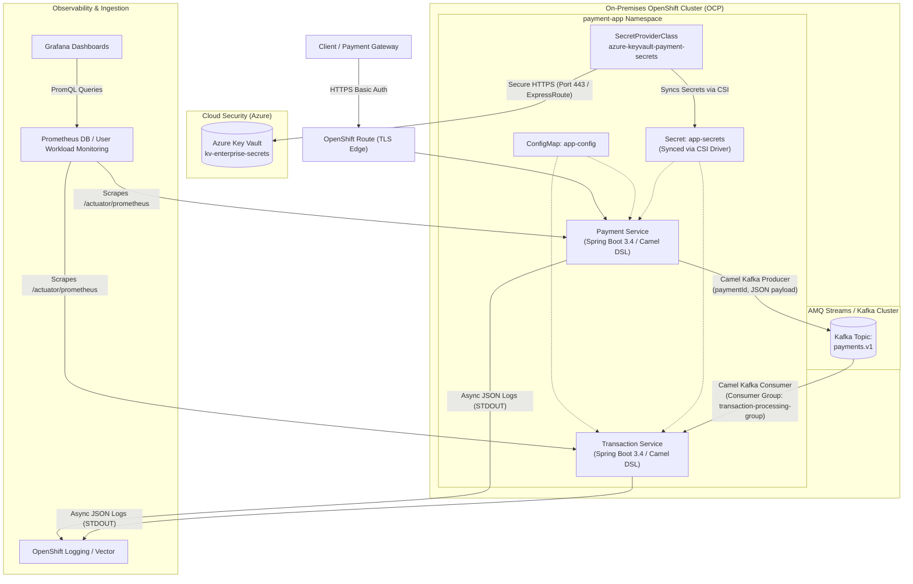
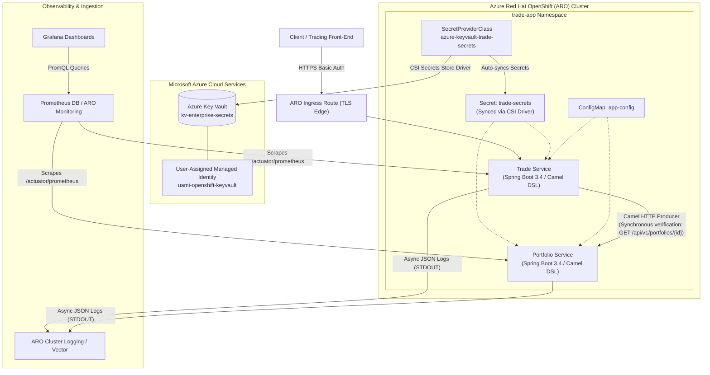

# Enterprise Container Architecture: On-Premises OCP & Azure Red Hat OpenShift (ARO)

This document establishes the authoritative architecture, integration patterns, and operational standards for the four reference microservices across **On-Premises OpenShift Container Platform (OCP)** and **Azure Red Hat OpenShift (ARO)**.

---

## 1. Architectural Comparison Matrix

| Capability | On-Premises Banking Platform | ARO Equities Trading Platform |
| :--- | :--- | :--- |
| **Domain** | Payment Ingestion & Settlement | Equities Order Routing & Holdings |
| **Microservices** | [`payment-service`](../On-Prem-Microservice-1) & [`transaction-service`](../On-Prem-Microservice-2) | [`portfolio-service`](../ARO-Microservice-1) & [`trade-service`](../ARO-Microservice-2) |
| **Namespaces** | `payment-app` | `trade-app` |
| **Runtime & Language** | Java 21 LTS, Spring Boot 3.4.13, Apache Camel 4.8.5 DSL | Java 21 LTS, Spring Boot 3.4.13, Apache Camel 4.8.5 DSL |
| **Interconnection Pattern** | Asynchronous Event-Driven via **AMQ Streams (Kafka)** | Synchronous REST via **Apache Camel HTTP component** |
| **External Security** | Spring Security HTTP Basic Auth (CSI-injected credentials) | Spring Security HTTP Basic Auth (CSI-injected credentials) |
| **Secrets Engine** | **Azure Key Vault** via Secrets Store CSI Driver (Service Principal) | **Azure Key Vault** via Secrets Store CSI Driver (Managed Identity) |
| **HTTPS Ingress** | OpenShift Edge TLS Route & Container TLS | ARO Edge TLS Route & Container TLS |
| **Logging Format** | Asynchronous JSON via Logstash Logback Encoder | Asynchronous JSON via Logstash Logback Encoder |
| **Telemetry & Metrics** | OpenTelemetry / Prometheus (`/actuator/prometheus`) | OpenTelemetry / Prometheus (`/actuator/prometheus`) |
| **Dashboards** | Pre-built Grafana Dashboard (`banking-platform-dashboard.json`) | Pre-built Grafana Dashboard (`trading-platform-dashboard.json`) |
| **Scalability Target** | Declarative Manual Scaling: 3–5 Pod Replicas | Declarative Manual Scaling: 3–5 Pod Replicas |
| **Container Base** | Red Hat Universal Base Image (UBI 9) OpenJDK 21 Runtime | Red Hat Universal Base Image (UBI 9) OpenJDK 21 Runtime |

---

## 2. On-Premises Architecture: Banking Platform

The On-Premises architecture demonstrates a high-throughput, event-driven banking pipeline using **Apache Camel DSL** and **Red Hat AMQ Streams (Kafka)**.

### Microservice Roles (On-Premises)

#### 1. Payment Service (`payment-service`)
- **Role**: High-volume payment submission REST ingestion service.
- **Port**: 8443 (HTTP behind TLS Ingress Route).
- **Core Endpoints**:
  - `GET /api/v1/payments/ping`: Lightweight liveness verification returning component status.
  - `POST /api/v1/payments`: Validates incoming payment requests (amount, currency, source/destination accounts) and serializes them into standardized JSON event payloads.
- **Camel Kafka Producer**:
  - Sets the Kafka message key to `${paymentId}`.
  - Dispatches the message to AMQ Streams topic `payments.v1`.
  - Returns `HTTP 202 Accepted` with correlation ID and processing confirmation.

#### 2. Transaction Service (`transaction-service`)
- **Role**: Event-driven transaction settlement processor.
- **Port**: 8443 (HTTP/HTTPS).
- **Core Endpoints**:
  - `GET /api/v1/transactions/ping`: Service health verification.
  - `GET /api/v1/transactions/stats`: Exposes real-time throughput counters (total processed, total settled value, last settlement timestamp).
- **Camel Kafka Consumer**:
  - Binds to Kafka topic `payments.v1` in consumer group `transaction-processing-group`.
  - Unmarshals payment events, executes financial settlement logic, and issues an immutable transaction ID (`TX-XXXXXXXX`).
  - Records full structured MDC audit logs with `traceId` and `paymentId`.

---

## 3. Azure Red Hat OpenShift (ARO) Architecture: Trading Platform

The ARO architecture demonstrates a cloud-native financial trading platform executing low-latency synchronous inter-service communication over the OpenShift Software-Defined Network (SDN).

### Microservice Roles (ARO)

#### 1. Trade Service (`trade-service`)
- **Role**: Order ingestion, validation, and synchronous execution coordinator.
- **Port**: 8443.
- **Core Route (`POST /api/v1/trades`)**:
  - Validates order parameters (symbol, side BUY/SELL, quantity, price limit).
  - Triggers an internal Apache Camel HTTP producer call to query `portfolio-service` (`http://portfolio-service:8443/api/v1/portfolios/{accountId}`).
  - Validates account status, verifies sufficient cash balance (for BUY orders) or sufficient asset holding (for SELL orders).
  - Executes the order, updates portfolio status, and returns a verified trade execution ticket.

#### 2. Portfolio Service (`portfolio-service`)
- **Role**: Asset management, holdings ledger, and account balances provider.
- **Port**: 8443.
- **Core Route (`GET /api/v1/portfolios/{accountId}`)**:
  - Retrieves real-time holdings, cash balances, and currency denomination for requested account IDs.
  - Emits non-blocking asynchronous JSON logs for auditing read access.

---

## 4. Cross-Cutting Architectural Standards

### 4.1 Zero-Credential Policy & Unified Secrets Engine
- **Single Source of Truth**: All secrets across On-Premises OCP and cloud ARO are stored exclusively in **Azure Key Vault**.
- **No In-Code Credentials**: No passwords, API keys, or certificates are committed to Git.
- **Dynamic Kubernetes Secret Injection**: The **Secrets Store CSI Driver** queries Azure Key Vault and projects values directly into native Kubernetes Secrets (`app-secrets` and `trade-secrets`).
- **Application Decoupling**: Applications read credentials via standard Spring environment variable injection (`envFrom: secretRef`), eliminating vendor-specific SDK dependencies in container code.

### 4.2 High-Performance Asynchronous Logging
- All applications use Logback with `net.logstash.logback.encoder.LogstashEncoder` wrapped in non-blocking `AsyncAppender`.
- **Default Pipeline**: Logs are written to `STDOUT` as structured JSON, collected by OpenShift Logging (Vector / Fluentd), and indexed in enterprise logging stores.
- **Optional Direct Shipping**: Setting `LOGGING_EXTERNAL_HOST` activates an optional secure TLS TCP socket appender for shipping directly from the pod.

### 4.3 Full-Stack Observability
- **Micrometer & OpenTelemetry**: Instruments HTTP request latency percentiles, Camel route processing durations, JVM memory pools, thread states, and garbage collection pauses.
- **Prometheus Scraping**: Native metrics exposed via `/actuator/prometheus` and scraped every 15 seconds by OpenShift CoreOS `ServiceMonitor` resources.
- **Grafana Visualization**: Out-of-the-box dashboards visualize platform health, message throughput, and route execution errors.
